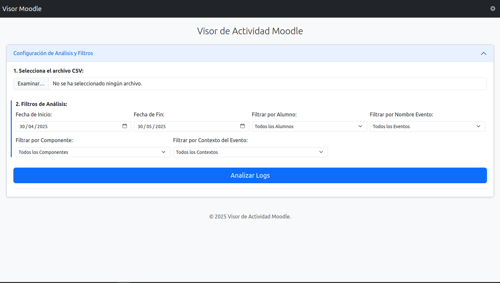
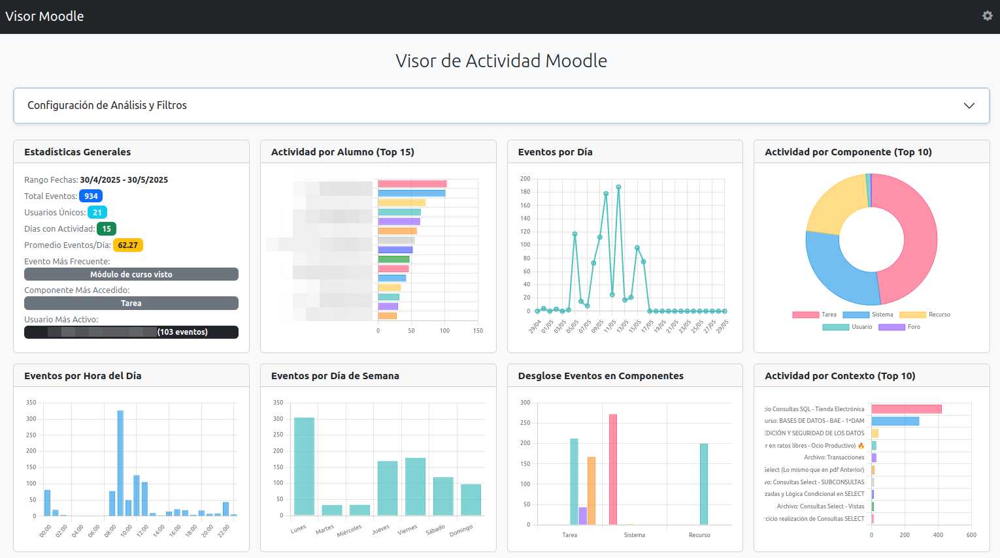
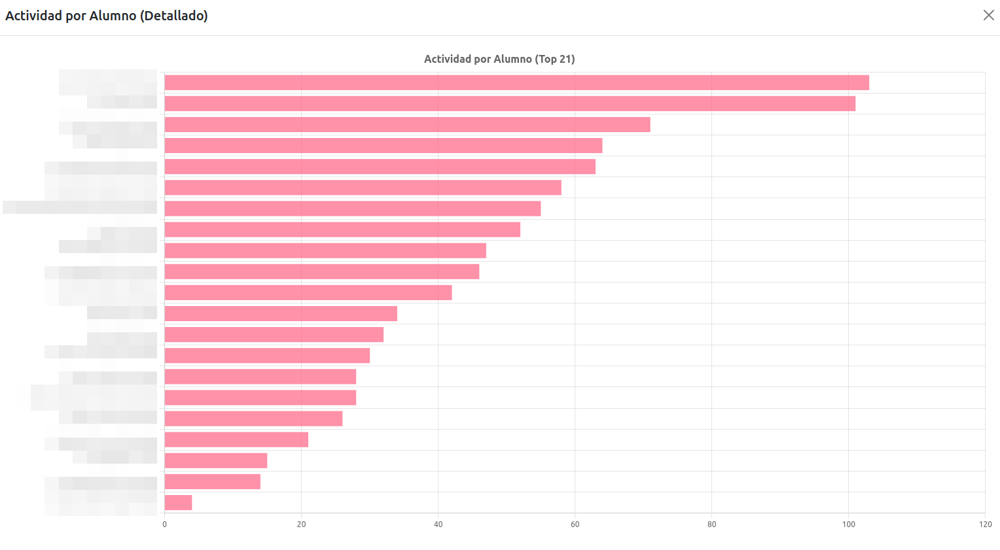
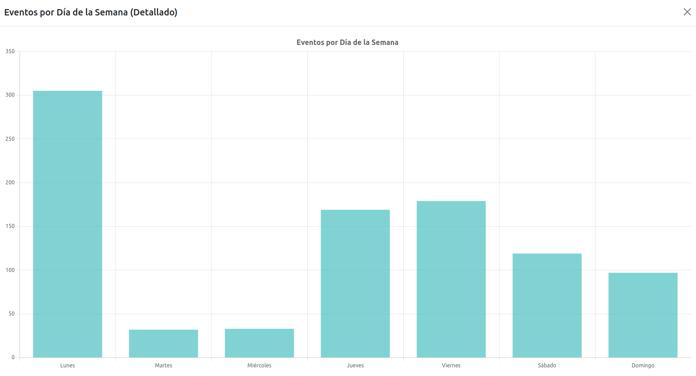
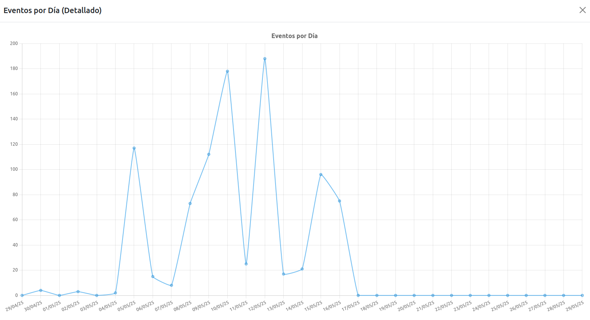
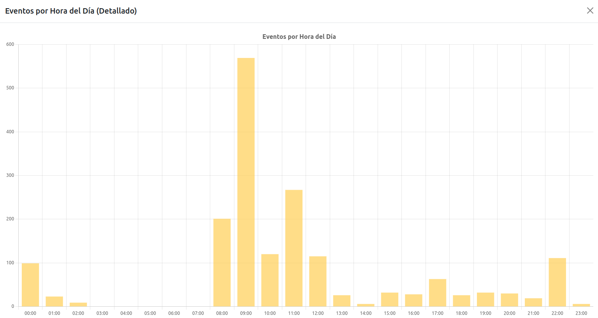

# Visor de Actividad Moodle 📊

### [Abrir el visor de seguimiento en GitHub Pages](https://soyunomas.github.io/moodle-activity-viewer/)

**Acceso directo:** [https://soyunomas.github.io/moodle-activity-viewer/](https://soyunomas.github.io/moodle-activity-viewer/)

No necesitas instalar nada: exporta los registros CSV de Moodle, abre el visor y selecciona el archivo. El análisis se hace en tu navegador; los CSV no se envían a un servidor por esta herramienta.

Un visor interactivo, del lado del cliente, para los registros de actividad de Moodle. ¡Analiza fácilmente las exportaciones de logs CSV de Moodle directamente en tu navegador sin necesidad de configuración en el servidor! 🚀

Esta herramienta permite a educadores, administradores y usuarios de Moodle visualizar y filtrar rápidamente la actividad de los alumnos. No necesita backend: la interfaz se sirve como HTML y scripts JavaScript locales, apoyados en librerías de presentación cargadas desde CDN.

# Visor de Actividad Moodle Avanzado

Herramienta de análisis de logs de Moodle del lado del cliente, diseñada para ofrecer visualizaciones interactivas y detalladas sobre la actividad en la plataforma. Carga tus archivos CSV y explora los datos sin necesidad de subirlos a un servidor.

## ✨ Características Principales

*   **📁 Carga Directa de CSV:** Procesa archivos CSV de logs de Moodle estándar directamente desde tu ordenador.
*   **📊 Paneles de Visualización (Dashboards):** Un conjunto completo de gráficos para analizar la actividad desde múltiples perspectivas:
    *   **Resumen General:**
        *   Estadísticas Clave (Total Eventos, Usuarios Únicos, Días Activos, Promedios, etc.).
    *   **Análisis de Actividad Principal:**
        *   Actividad por Alumno (Top N en panel, todos en modal).
        *   Eventos a lo Largo del Tiempo (por Día).
        *   Actividad por Componente Moodle (Top N en panel, todos en modal).
        *   Actividad por Contexto del Evento (Top N en panel, todos en modal).
    *   **Patrones Temporales:**
        *   Eventos por Hora del Día.
        *   Eventos por Día de la Semana.
    *   **Análisis Detallado de Componentes:**
        *   Desglose de Eventos Específicos dentro de los Componentes Principales.
    *   **Gráficos de Dispersión (Scatter Plots):**
        *   Usuarios Únicos vs. Eventos Totales (por Día).
        *   Componentes Únicos Accedidos vs. Eventos Totales (por Alumno).
        *   Eventos de Visualización vs. Eventos de Participación (por Alumno).
    *   **Gráficos de Burbujas (Bubble Charts) para Análisis Multidimensional:**
        *   Análisis de Alumnos: Días Activos (eje X) vs. Promedio Eventos/Día (eje Y) vs. Total Eventos (tamaño burbuja).
        *   Análisis de Componentes: Usuarios Únicos (eje X) vs. Total Eventos (eje Y) vs. Promedio Eventos/Usuario (tamaño burbuja).
        *   Análisis de Contextos: Alumnos Activos (eje X) vs. Promedio Eventos/Alumno (eje Y) vs. Total Eventos (tamaño burbuja).
    *   **Análisis Basado en IP (si la columna está disponible en el CSV):**
        *   Top IPs por Número de Eventos.
        *   Top IPs por Número de Alumnos Únicos.
        *   Top Alumnos por Número de IPs Únicas.

*   **🔍 Filtrado Potente y Flexible:**
    *   📅 **Rango de Fechas:** Enfócate en periodos específicos.
    *   🕒 **Rango de Horas:** Precisa el análisis a franjas horarias específicas del día.
    *   👤 **Usuario:** Analiza la actividad de todos los usuarios o de un solo alumno.
    *   🏷️ **Nombre del Evento:** Aísla acciones particulares (ej: "Módulo del curso visto").
    *   🧩 **Componente:** Profundiza en áreas específicas de Moodle (ej: Foro, Tarea).
    *   🌍 **Contexto del Evento:** Filtra por el curso, actividad o recurso específico.
    *   🌐 **Dirección IP:** Filtra eventos originados desde IPs específicas (si la columna existe en el CSV).
    *   📊 **Opción "Incluir ítems con 0 actividad":** Controla si los rankings (alumnos, componentes, etc.) muestran entidades del dataset base aunque no tengan actividad según los filtros actuales.

*   **🛠️ Configuración Personalizada:**
    *   🚫 **Exclusiones Globales Avanzadas:** Define subcadenas (insensibles a mayúsculas/minúsculas, separadas por coma) para excluir automáticamente del análisis:
        *   Nombres de Alumnos (ej: "admin", "test user").
        *   Nombres de Componentes (ej: "Sistema", "Bloque X").
        *   Nombres de Evento (ej: "course viewed", "user loggedin").
        *   Contextos de Evento (ej: "Curso de Pruebas", "Actividad Ejemplo").
    *   🎨 **Patrones de Eventos para Gráfico "Visualización vs. Participación":**
        *   Define subcadenas para identificar eventos de "Visualización" (ej: "viewed", "consultado").
        *   Define subcadenas para identificar eventos de "Participación" (ej: "submitted", "posted").

## Seguimiento docente: de los registros a preguntas concretas

Los paneles aparecen **ordenados por utilidad durante el curso**. Los primeros permiten identificar a quién conviene preguntar cómo va; los últimos completan el contexto técnico. Los indicadores nunca equivalen a calificaciones ni prueban abandono.

1. **Continuidad semanal:** una matriz por alumno y semana indica cuándo aparecen o dejan de aparecer eventos en el CSV. Pulsa en un nombre para abrir su perfil.
2. **Evolución individual:** gráfico semanal, días activos, último evento y sesiones aproximadas. Útil para comprobar cambios tras una tutoría.
3. **Comparación entre periodos:** compara intervalos consecutivos con el mismo número de días y con los mismos filtros. Se oculta si el CSV no cubre íntegramente el tramo anterior.
4. **Mapa de calor por día y hora:** identifica en qué momentos se concentra el uso de Moodle; útil para planificar avisos o entender los días previos a las entregas.
5. **Tipos de interacción:** consulta, participación y otras acciones, clasificados por patrones editables. Permite distinguir cantidad de accesos y naturaleza de las acciones registradas.
6. **Sesiones aproximadas:** agrupa eventos por alumno con pausas de hasta 30 minutos. La duración es solo el intervalo entre eventos, no tiempo real de estudio.
7. **Concentraciones inusuales:** muestra determinadas ráfagas horarias con al menos 25 eventos y triple de la mediana de actividad por hora. Solo sirve para revisar su contexto.
8. **Calidad del CSV:** contabiliza registros procesados, descartes, alumnos sin nombre y columnas ausentes.

Debajo aparecen **los 19 gráficos originales y el resumen general**, priorizados por análisis de alumnos, evolución temporal, interacción, contexto, componentes, dispersión, IP y cuestionarios. Los gráficos de cuestionarios solo aparecen cuando hay intentos reconocibles.

### Cómo interpretar las señales

- **Semanas sin registros:** revisar si hay incidencias de acceso, actividades fuera de Moodle o problemas de planificación. No deducir desinterés automáticamente.
- **Muchas visitas y pocas entregas:** comprobar las instrucciones, la dificultad y los plazos de las actividades.
- **Concentración de eventos en una hora:** verificar si se trata de un cuestionario, un recurso que genera varios eventos o una sesión de trabajo intensiva.
- **Caída respecto al periodo anterior:** comparar solo periodos completos y equivalentes; tener presente el calendario académico.
- **Filas descartadas:** revisar primero la exportación antes de interpretar una ausencia de eventos.

Cada panel y gráfico incluye un **botón de ayuda** con definición, lectura, ejemplos de uso docente y límites de interpretación. Los ajustes de exclusiones y patrones siguen disponibles en la rueda de Configuración.

### Recomendación para el seguimiento

Exporta el CSV con un intervalo que abarque las semanas que quieres observar, preferiblemente con algo de histórico previo para permitir comparaciones. Los días sin actividad se cuentan **hasta la última fecha presente en el CSV**, no hasta hoy. Si hay alumnos que nunca han generado registros, no pueden inferirse a partir del CSV: contrasta con la lista de matriculados en Moodle.

## 📸 Capturas de Pantalla

<table align="center" style="width:100%; border-collapse: collapse;">
  <thead>
    <tr>
      <th style="text-align:center; padding: 8px; border: 1px solid #ddd;">Panel de Filtros</th>
      <th style="text-align:center; padding: 8px; border: 1px solid #ddd;">Gráficas Disponibles</th>
    </tr>
  </thead>
  <tbody>
    <tr>
      <td style="text-align:center; padding: 8px; border: 1px solid #ddd;"></td>
      <td style="text-align:center; padding: 8px; border: 1px solid #ddd;"></td>
    </tr>
    <tr>
      <th style="text-align:center; padding: 8px; border: 1px solid #ddd;">Ejemplo Gráfica Ampliada 1</th>
      <th style="text-align:center; padding: 8px; border: 1px solid #ddd;">Ejemplo Gráfica Ampliada 2</th>
    </tr>
    <tr>
      <td style="text-align:center; padding: 8px; border: 1px solid #ddd;"></td>
      <td style="text-align:center; padding: 8px; border: 1px solid #ddd;"></td>
    </tr>
    <tr>
      <th style="text-align:center; padding: 8px; border: 1px solid #ddd;">Ejemplo Gráfica Ampliada 3</th>
      <th style="text-align:center; padding: 8px; border: 1px solid #ddd;">Ejemplo Gráfica Ampliada 4</th>
    </tr>
    <tr>
      <td style="text-align:center; padding: 8px; border: 1px solid #ddd;"></td>
      <td style="text-align:center; padding: 8px; border: 1px solid #ddd;"></td>
    </tr>
  </tbody>
</table>

## 🚀 Demo en Vivo en GitHub Pages

Prueba el Visor de Actividad Moodle en vivo:
[**Abrir el visor en GitHub Pages**](https://soyunomas.github.io/moodle-activity-viewer/)

## 📋 Cómo Exportar Logs de Moodle como CSV

Para usar este visor, primero necesitarás exportar los logs relevantes desde tu instancia de Moodle. Los pasos exactos pueden variar ligeramente dependiendo de tu versión de Moodle y tema, pero aquí tienes una guía general:

1.  **Inicia sesión en Moodle:** Accede a tu sitio Moodle con una cuenta de administrador o un rol de usuario que tenga permiso para ver los logs del sitio (ej: gestor).
2.  **Navega a Administración del Sitio:**
    *   Normalmente se encuentra en el bloque de navegación principal o en el menú de usuario.
3.  **Encuentra los Logs:**
    *   Ve a **Administración del sitio** -> **Informes** -> **Registros** (o "Logs").
    *   Alternativamente, podrías encontrar "Registros activos" (o "Live logs") y luego una opción para ver "Registro estándar" (o "Standard log") o "Todos los registros".
4.  **Aplica Filtros Iniciales (Opcional pero Recomendado):**
    *   **Curso:** Selecciona "Todos los cursos" o un curso específico.
    *   **Participantes:** Selecciona "Todos los participantes" (puedes filtrar usuarios en este visor).
    *   **Días:** Selecciona "Todos los días" o un rango de fechas amplio (puedes refinar fechas en este visor).
    *   **Actividades:** Selecciona "Todas las actividades".
    *   **Acciones:** Selecciona "Todas las acciones".
    *   **Tipo de Registro:** Asegúrate de que "Registro estándar" (o similar, no "Registro heredado" si es una opción) esté seleccionado.
5.  **Obtén los Logs:** Haz clic en el botón "Conseguir estos registros" (o similar).
6.  **Descarga como CSV:**
    *   Desplázate hasta la parte inferior de la página del informe de logs.
    *   Busca una sección "Descargar datos de la tabla como" o "Exportar".
    *   Elige **"Valores separados por comas (.csv)"** y descarga el archivo.

**➡️ Columnas CSV Importantes:**
Este visor depende de encabezados de columna específicos de la exportación CSV de Moodle. Los encabezados esperados por defecto (en español, según tu HTML) son:
*   `Hora`
*   `Nombre completo del usuario`
*   `Contexto del evento`
*   `Componente`
*   `Nombre evento`
*   `Descripción`

Si tu exportación de Moodle usa nombres diferentes, necesitarás actualizar el objeto `CSV_COLUMN_MAPPING` dentro de `visor_actividad_moodle.html`.

## 💻 Cómo Usar el Visor

1.  **Abre el visor:** utiliza el enlace principal de GitHub Pages al comienzo del README. También puedes descargar el repositorio y abrir `index.html` o `visor_actividad_moodle.html`.
2.  **Selecciona el Archivo CSV:**
    *   En la barra superior compacta, selecciona el CSV exportado desde Moodle.
3.  **Aplica Filtros (Opcional):**
    *   Abre el panel lateral **Filtros** cuando necesites ajustar el periodo o el alumnado.
    *   Ajusta la **Fecha de Inicio** y **Fecha de Fin**.
    *   Usa los menús desplegables para filtrar por **Alumno**, **Nombre Evento**, **Componente** o **Contexto del Evento** específico.
4.  **Analiza:**
    *   Haz clic en **Analizar**. Los filtros actualizan el análisis después de cargar el CSV.
5.  **Explora los Resultados:**
    *   Consulta primero el bloque **Seguimiento docente** y después los gráficos complementarios.
    *   Haz clic en cualquier tarjeta de gráfico pequeña para ver una versión ampliada en un modal.
    *   Desplázate por la tabla "Detalle de Logs Filtrados" en la parte inferior.
6.  **Configura Exclusiones (Opcional):**
    *   Haz clic en el icono de engranaje (⚙️) en la barra de navegación superior.
    *   Introduce subcadenas de nombres de usuario separadas por comas para excluir (ej: "usuario de prueba, admin, soporte").
    *   Haz clic en "Guardar Cambios y Reanalizar". Las exclusiones se guardan en el almacenamiento local de tu navegador.

## 💡 Manejo de Archivos de Log Grandes: Pre-filtrado para Mejor Rendimiento

Si trabajas con archivos de logs de Moodle que son muy extensos (por ejemplo, de varios meses o con muchos usuarios), su procesamiento completo en el navegador puede consumir bastantes recursos y ralentizar la aplicación. Para optimizar el rendimiento en análisis posteriores sobre subconjuntos específicos de estos datos, puedes utilizar la propia herramienta para generar versiones más pequeñas y manejables de tus logs.

Sigue estos pasos:

1.  **Carga Inicial del Log Grande:**
    *   Selecciona tu archivo CSV de log completo usando el selector "1. Selecciona el archivo CSV:".
    *   *Nota: La carga y el primer análisis de un archivo extremadamente grande pueden tomar tiempo, ya que todo el procesamiento se realiza en tu navegador.*

2.  **Aplica Filtros Estratégicos:**
    *   Define filtros que reduzcan significativamente el volumen de datos, pero que aún contengan la información que deseas analizar repetidamente. Por ejemplo:
        *   Un **rango de fechas** más acotado (ej. el último mes, un trimestre específico).
        *   Excluir **alumnos** o **componentes** que no son relevantes para tu análisis recurrente (puedes usar los filtros directos o las exclusiones globales en la configuración ⚙️).
        *   Filtrar por un **contexto de evento** específico si te enfocas siempre en un curso particular.
    *   Haz clic en el botón **"Analizar Logs"** para aplicar estos filtros.

3.  **Descarga el Log Filtrado:**
    *   Una vez que los resultados del análisis se muestren, dirígete a la sección **"Detalle de Logs Filtrados"** al final de la página.
    *   Haz clic en el botón **<i class="bi bi-download"></i> Descargar CSV**.
    *   Se descargará un nuevo archivo CSV (ej: `moodle_logs_filtrados_AAAAMMDD_HHMMSS.csv`) que contiene **únicamente** las entradas de log que cumplen con los criterios de filtrado que aplicaste.

4.  **Reutiliza el Log Filtrado:**
    *   ¡Este nuevo archivo CSV es tu log optimizado! En futuras sesiones de análisis, en lugar de cargar el archivo original grande, puedes **seleccionar directamente este archivo CSV filtrado y más pequeño**.
    *   La aplicación lo procesará mucho más rápido, permitiéndote trabajar de manera más fluida con el subconjunto de datos relevante.

Este proceso te permite crear "vistas" más pequeñas y enfocadas de tus logs extensos, sin modificar tu archivo de log original, y aprovechando la capacidad de filtrado de esta herramienta para mejorar tu flujo de trabajo.

## 🛠️ Construido Con

*   **HTML5:** Marcado semántico.
*   **CSS3:** Estilos personalizados y diseño responsivo.
*   **Bootstrap 5:** Para componentes de UI, maquetación y responsividad.
*   **JavaScript (ES6+):** Toda la lógica del lado del cliente, parseo de datos y manipulación del DOM.
*   **Chart.js:** Para crear gráficos interactivos y atractivos.
*   **date-fns:** Para un parseo y manipulación de fechas robusto.

## 📝 TO-DO / Mejoras Futuras

*   [ ] **Exportar Informe Completo:** Opción para descargar la vista actual del panel (quizás como PDF o una colección de imágenes y resúmenes de datos). 📥
*   [ ] **Selección Avanzada de Columnas:** Permitir a los usuarios mapear columnas CSV si su exportación tiene encabezados diferentes, directamente desde la UI.
*   [x] **Filtrado de Tiempo Más Granular:** Añadir filtros por hora del día (ej: mostrar actividad solo entre las 9 AM y las 5 PM). ⏱️
*   [ ] **Guardar/Cargar Configuraciones de Filtro:** Permitir a los usuarios guardar un conjunto completo de filtros aplicados (fechas, usuario, evento, etc.) y recargarlos más tarde.
*   [ ] **Accesibilidad Mejorada (A11Y):** Revisar y mejorar aún más los atributos ARIA y la navegación por teclado para todos los componentes. ♿
*   [ ] **Temas/Personalización:** Opciones básicas para que los usuarios cambien los colores de los gráficos o un tema claro/oscuro para el visor. 🎨
*   [ ] **Análisis de Rendimiento:** Probar con archivos CSV extremadamente grandes y optimizar el parseo/renderizado si se encuentran cuellos de botella (ej: considerar Web Workers para el parseo).

## 📜 Licencia

Este proyecto está licenciado bajo la Licencia MIT. Consulta el archivo [LICENSE.md](LICENSE.md) para más detalles.

---

¡Feliz análisis de logs de Moodle! Si encuentras útil esta herramienta, ¡considera marcar el repositorio con una estrella! ⭐
